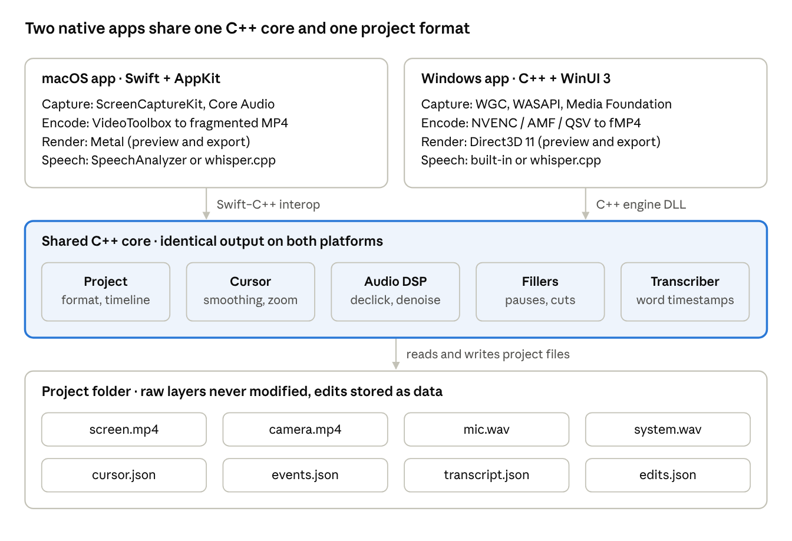
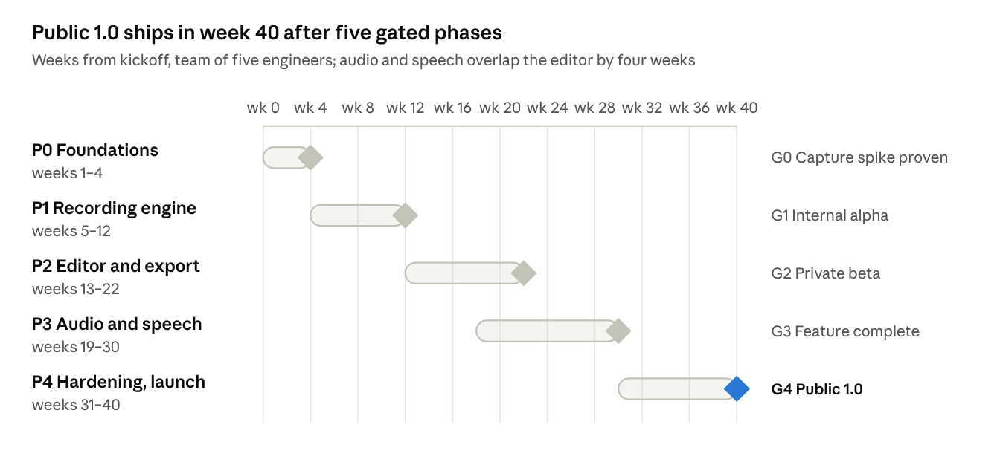

# Demo Recorder — Feature Spec & Development Plan

Last updated: 2026-11-12

## Overview

Demo Recorder is a fully native screen recorder for macOS and Windows. It produces polished product demos and tutorials with no manual editing, and every recording, caption and audio cleanup step runs on the user's machine.

**Target users:** founders, product managers, developer advocates, support teams and educators who record product walkthroughs, bug reports and tutorials.

**Positioning:** no current tool combines Screen Studio-style automatic polish, first-class support on both macOS and Windows, and on-device AI. Those three together are the wedge.

| Product | Platforms | Strength | Gap we exploit |
| --- | --- | --- | --- |
| Screen Studio | macOS | Auto-zoom, smooth cursor, polished output | Mac only, light editing |
| Loom | Mac, Windows, Web | Instant share links, team features | Plain-looking output, cloud-dependent, priced per seat |
| Cap | Mac, Windows | Open source, Tauri + Rust | Young, not fully native, rough edges |
| OBS Studio | All | Free, powerful | Complex, no automatic polish |
| Camtasia / ScreenFlow | Win + Mac / Mac | Full timeline editors | Heavy, dated UX |

**Product principles**

1. **Fully native, maximum performance.** Swift + AppKit + Metal on macOS; C++ + WinUI 3 + Direct3D 11 on Windows. Frames stay on the GPU from capture to encoder.
2. **Record raw, polish later.** Capture keeps each source (screen, camera, mic, system audio, cursor, keys) as a separate layer. The editor applies every effect non-destructively.
3. **On-device by default.** Captions, noise reduction, click removal and filler detection run locally. The only optional network use is a user-approved model download.
4. **Same output on both platforms.** One shared C++ core holds the project format and the effects math, so a project renders identically on Mac and Windows.
5. **Privacy first.** No telemetry without consent. Keystroke timing is stored without key identity unless the keystroke overlay is on.

## Feature specification

The 1.0 release ships every MVP and V1 feature below on both platforms. Later features are planned but not committed. Priority: **MVP** = first beta, **V1** = public 1.0, **Later** = after 1.0.

### 1. Capture

| ID | Feature | Priority | Requirement |
| --- | --- | --- | --- |
| C-1 | Full screen, single window, area | MVP | Pick any display, any window, or drag a region; region snaps to common aspect ratios (16:9, 4:3, 1:1, 9:16) |
| C-2 | Frame rate and resolution | MVP | 30 / 60 fps, native resolution up to 5K; 120 fps on displays that support it (Later) |
| C-3 | System audio | MVP | Capture all system audio; exclude Demo Recorder's own sounds |
| C-4 | Per-app audio | V1 | Capture audio from selected apps only (macOS 14.2+ process taps, Windows 11 process loopback) |
| C-5 | Microphone | MVP | Any input device, live level meter, gain; recorded raw as a separate track |
| C-6 | Webcam | MVP | Any camera, recorded as a separate track at up to 1080p30 |
| C-7 | Controls | MVP | Global hotkeys, 3-second countdown, pause/resume, stop, restart, discard |
| C-8 | Exclusions | V1 | Hide the Demo Recorder UI, chosen windows, and desktop icons from the capture |
| C-9 | Crash-safe recording | MVP | Fragmented MP4 tracks; after a crash, all audio and video up to the last fragment is recoverable |
| C-10 | Long recordings | V1 | 2+ hour sessions with no drift between audio and video (±1 frame) |
| C-11 | iPhone / Android device capture | Later | Record a connected phone screen as a source |

### 2. Cursor and input logging

| ID | Feature | Priority | Requirement |
| --- | --- | --- | --- |
| I-1 | Cursor as data | MVP | Screen is captured without the cursor; cursor position, shape and clicks are logged at ≥120 Hz to `cursor.json` |
| I-2 | Click and key timing | MVP | Mouse down/up and key down/up timestamps logged to `events.json` against the master clock; no key identity stored |
| I-3 | Keystroke overlay data | V1 | Key identity stored only when the overlay is enabled; never while a password field is focused |
| I-4 | Cursor shape capture | MVP | Store each cursor image once (arrow, I-beam, hand, custom) so it can be redrawn at any size |

### 3. Editor

| ID | Feature | Priority | Requirement |
| --- | --- | --- | --- |
| E-1 | Live preview | MVP | GPU-composited preview of all layers at 60 fps on reference hardware |
| E-2 | Trim and cut | MVP | Trim start/end, split, delete sections; all non-destructive |
| E-3 | Speed sections | V1 | Speed up any section 1.25×–8×; auto-suggest speed-ups for typing and idle stretches |
| E-4 | Auto-zoom | V1 | Zoom regions generated from clicks and typing; user edits zoom level, timing and easing |
| E-5 | Transcript editing | V1 | Delete words in the transcript to cut the video |
| E-6 | Undo / redo | MVP | Unlimited undo for every edit, persisted with the project |
| E-7 | Multiple clips | Later | Join several recordings into one timeline |

### 4. Visual effects

| ID | Feature | Priority | Requirement |
| --- | --- | --- | --- |
| V-1 | Backgrounds | MVP | Solid, gradient, image or wallpaper behind the recording; padding, rounded corners, shadow |
| V-2 | Cursor effects | V1 | Resize, smooth motion, highlight clicks, hide when idle, swap cursor style |
| V-3 | Webcam styling | V1 | Shape (circle, rounded rect), size, position, border; per-section layouts (full-screen camera, hidden) |
| V-4 | Keystroke overlay | V1 | Show pressed shortcuts on screen with configurable style |
| V-5 | Blur and redact | V1 | Blur or pixelate a region for a time range; track a window when it moves (Later) |
| V-6 | Annotations | Later | Arrows, text, highlight boxes |

### 5. Audio processing (all DSP, no models)

| ID | Feature | Priority | Requirement |
| --- | --- | --- | --- |
| A-1 | Keyboard and click removal | V1 | Event-guided transient removal: room-tone fill in silence, harmonic/percussive separation and LPC gap filling over speech; strength slider; detected clicks shown on the waveform |
| A-2 | Noise reduction | V1 | MMSE-LSA spectral suppression with minimum-statistics noise estimation; strength slider |
| A-3 | Studio sound chain | V1 | High-pass, EQ, compressor, de-esser, loudness normalization to −16 LUFS (configurable) |
| A-4 | Pause shortening | V1 | Detect pauses longer than a threshold and suggest shortening them to ~300 ms |
| A-5 | System audio ducking | V1 | Lower system audio automatically while the user speaks |
| A-6 | Raw always available | MVP | Every processing step can be turned off; the raw mic track is never modified |

### 6. Captions and speech recognition

| ID | Feature | Priority | Requirement |
| --- | --- | --- | --- |
| S-1 | On-device transcription | V1 | Word-level transcript with timestamps, produced after recording in the background |
| S-2 | Captions | V1 | Styled burned-in captions (including word-by-word highlight); SRT and VTT export |
| S-3 | Transcript editing | V1 | Fix misheard words; re-transcribe with a better engine when installed |
| S-4 | Languages | V1 | Auto-detect language; English must reach the quality bar, other languages best effort |
| S-5 | Live captions while recording | Later | Streaming transcription during capture |
| S-6 | Translated captions | Later | On-device translation of captions |

Recognition engines by platform:

| Platform | Default engine | Optional upgrade |
| --- | --- | --- |
| macOS 26+ | Apple SpeechAnalyzer (0 MB, part of macOS) | Not needed |
| macOS 14–15 | None, or Apple SFSpeechRecognizer on-device (lower quality) | Whisper large-v3-turbo download (~550 MB) |
| Windows | Basic built-in recognizer (see open decision D1) | Whisper large-v3-turbo download (~550 MB) |

### 7. Filler-word removal

| ID | Feature | Priority | Requirement |
| --- | --- | --- | --- |
| F-1 | Filled-pause detection | V1 | DSP detection of "um" and "uh" (duration, flat pitch, stable vowel, nasal ending, bordering pauses) |
| F-2 | Suggested cuts | V1 | Fillers and long pauses listed as suggestions; user accepts or rejects each one, or all |
| F-3 | Clean cuts | V1 | Audio cut at zero crossings with a 10–30 ms crossfade; webcam cuts crossfaded or hidden under a zoom |
| F-4 | Word fillers | Later | "like", "you know", repeated words and false starts, from the transcript |

### 8. Model downloads

| ID | Feature | Priority | Requirement |
| --- | --- | --- | --- |
| M-1 | Opt-in download | V1 | Ask once with the size; Download now / Later / Never; never download silently |
| M-2 | Background transfer | V1 | Resumable download (BITS on Windows, background URLSession on macOS); pause on metered networks |
| M-3 | Integrity | V1 | Signed manifest (Ed25519) plus SHA-256 check before a model is loaded |
| M-4 | Hardware-matched model | V1 | Recommend turbo q5_0 on capable GPUs or ≥16 GB RAM, small otherwise |
| M-5 | Manage models | V1 | Settings page to view, delete, re-download, or import a model file offline |
| M-6 | Enterprise policy | Later | Registry key / configuration profile to disable downloads or point to an internal server |

### 9. Export and sharing

| ID | Feature | Priority | Requirement |
| --- | --- | --- | --- |
| X-1 | Video export | MVP | MP4 (H.264, HEVC), up to 4K60, hardware-encoded; ProRes on macOS (V1) |
| X-2 | Presets | V1 | YouTube, social 9:16 and 1:1, GIF, small-file share preset |
| X-3 | Export speed | V1 | A 10-minute 1080p60 project exports in under 2 minutes on reference hardware |
| X-4 | Copy and drag out | V1 | Copy the exported file to the clipboard or drag it into another app |
| X-5 | Share links | Later | Optional hosted player with view analytics |

### 10. App shell

| ID | Feature | Priority | Requirement |
| --- | --- | --- | --- |
| P-1 | Menu bar / tray app | MVP | Start recording from the menu bar (macOS) or system tray (Windows) |
| P-2 | Permission onboarding | MVP | Step-by-step screens for every permission, with a live check of each |
| P-3 | Project library | MVP | List of recordings with thumbnails, duration, size; open, rename, duplicate, delete |
| P-4 | Auto-update | MVP | Sparkle on macOS; signed installer updates on Windows |
| P-5 | Localization | Later | UI in the top 8 languages |

## Platform matrix

Each platform uses its own native media and graphics APIs; only the project format, timeline and effects math are shared.

| Area | macOS | Windows |
| --- | --- | --- |
| Language | Swift 6 + C++20 (Swift/C++ interop) | C++20/23 with C++/WinRT; C# for UI (decision D3) |
| UI | AppKit (overlays, region picker, menu bar); SwiftUI for settings | WinUI 3 (Windows App SDK); SwapChainPanel for the preview |
| Screen capture | ScreenCaptureKit (`SCStream`), IOSurface-backed frames | Windows.Graphics.Capture, Direct3D11CaptureFramePool |
| Pixel format | NV12 / 10-bit requested directly from ScreenCaptureKit | BGRA → NV12/P010 on the GPU (ID3D11VideoProcessor or compute shader) |
| Video encoding | VideoToolbox `VTCompressionSession` (H.264, HEVC, ProRes) | NVENC, AMF, oneVPL; Media Foundation hardware MFT as fallback |
| File writing | AVAssetWriter, fragmented MP4 | Custom fragmented MP4 writer or libavformat (muxing only) |
| System audio | ScreenCaptureKit audio; Core Audio process taps (14.2+) | WASAPI loopback; process loopback (Windows 11) |
| Microphone | Core Audio / AVAudioEngine | WASAPI, MMCSS "Pro Audio" thread priority |
| Camera | AVCaptureSession | Media Foundation source reader (GPU surfaces) |
| Input events | CGEventTap | Low-level hooks (`WH_MOUSE_LL`, `WH_KEYBOARD_LL`), GetCursorInfo |
| Rendering (editor, export) | Metal, CVMetalTextureCache | Direct3D 11 |
| Text rendering | Core Text → glyph atlas | DirectWrite → glyph atlas |
| Decoding for export | AVAssetReader (hardware) | Media Foundation source reader (DXVA) |
| FFT / DSP | vDSP (Accelerate) | PFFFT in shared core |
| Speech recognition | SpeechAnalyzer (26+); whisper.cpp on Metal (download) | Built-in basic engine; whisper.cpp on CUDA / Vulkan / CPU (download) |
| Background download | Background URLSession | BITS |
| Updates | Sparkle | Signed installer with in-app updater (MSIX or WiX) |
| Signing | Developer ID + notarization | Azure Trusted Signing |
| Minimum OS | macOS 14 Sonoma (decision D2) | Windows 10 21H2; Windows 11 for per-app audio and borderless capture |
| Profiling | Instruments, Metal System Trace | PIX, Windows Performance Analyzer, GPUView |

**Permissions**

| Permission | macOS | Windows |
| --- | --- | --- |
| Screen capture | Screen Recording (TCC); periodic re-confirmation prompts | None; yellow border unless disabled (Windows 11) |
| Microphone | Microphone (TCC) | Privacy → Microphone toggle |
| Camera | Camera (TCC) | Privacy → Camera toggle |
| Input logging | Accessibility / Input Monitoring | None |
| Speech recognition | Speech Recognition (TCC) | None |

Distribution is direct download on both platforms. The Mac App Store is out of scope for 1.0 because the sandbox restricts event taps.

## Architecture

Each native app handles capture, encoding, rendering and speech engines. The shared C++ core holds everything that decides how a video looks, so a project renders the same on both platforms.

### Zero-copy recording pipeline

1. The OS capture API delivers each frame as a GPU texture (IOSurface on macOS, ID3D11Texture2D on Windows).
2. Color conversion to NV12 or P010 runs on the GPU; on macOS ScreenCaptureKit delivers NV12 directly.
3. The hardware encoder reads the GPU surface directly (VideoToolbox, NVENC / AMF / QSV).
4. Encoded packets are written to a fragmented MP4 every 1–2 seconds.
5. Audio, cursor and key events run on their own threads and are stamped against one master clock (`mach_absolute_time` / `QueryPerformanceCounter`).

Rules: no CPU readback of frames, no allocation in capture callbacks (preallocated buffer pools), lock-free ring buffers between threads, and no effects while recording.

### Project format

| File | Contents | Written by |
| --- | --- | --- |
| `project.json` | Version, sources, clock offsets, display info | Native app |
| `screen.mp4` | Screen video without cursor, high-bitrate | Native app |
| `camera.mp4` | Webcam video | Native app |
| `mic.wav`, `system.wav` | Raw audio tracks, 48 kHz | Native app |
| `cursor.json` | Cursor position, shape id and clicks at ≥120 Hz | Native app |
| `cursors/` | One image per cursor shape | Native app |
| `events.json` | Key and mouse down/up timestamps (no key identity by default) | Native app |
| `transcript.json` | Words with start, end, confidence, engine | Core |
| `edits.json` | Cuts, speed sections, zoom regions, effects, caption style, undo history | Core |
| `cache/` | Cleaned audio, waveform peaks, thumbnails; safe to delete | Core |

The format is versioned and documented in `docs/project-format.md`, and the core reads every older version.

### After-recording jobs

When recording stops, the core runs these jobs in the background at low priority, in order: align the clocks of all tracks, detect clicks and remove them, reduce noise and run the studio chain, transcribe, detect fillers and pauses, generate auto-zoom regions. Each job writes its own file, so the editor opens immediately and fills in as jobs finish.

### Transcriber interface

Every speech engine implements one interface in the core: `transcribe(audio, language) → [Word(text, start, end, confidence)]`. Implementations: `AppleSpeechTranscriber`, `WindowsBuiltInTranscriber`, `WhisperTranscriber`. The app uses the best installed engine, and captions, filler cuts and transcript editing never depend on which one ran.

## Non-functional requirements

Recording must never drop frames or slow the machine down; these budgets are release gates, measured on the reference hardware below.

**Reference hardware:** MacBook Air M1 8 GB (low end), MacBook Pro M3 Pro (high end); Windows laptop with Intel Core i5 12th gen + integrated graphics (low end), desktop with NVIDIA RTX 3060 (high end).

| Area | Requirement | Target |
| --- | --- | --- |
| Recording CPU | 1080p60 screen + mic + system audio + camera | ≤10% CPU on low-end reference |
| Recording 4K | 4K60 screen + audio | 0 dropped frames over 30 min on high-end reference |
| Memory while recording | Whole app | ≤400 MB |
| Start latency | Hotkey to first captured frame | ≤300 ms after countdown |
| A/V sync | Any track pair, any length up to 2 h | ±1 frame (≤17 ms at 60 fps) |
| Editor preview | All effects on | 60 fps at 1080p on low-end reference |
| Export | 10 min 1080p60 project | ≤2 min on low-end Mac, ≤3 min on low-end Windows |
| After-recording jobs | Audio cleanup for 10 min of audio | ≤30 s |
| Transcription | 10 min of audio, best installed engine | ≤2 min on low-end reference |
| Crash safety | Recording killed at any moment | ≤2 s of media lost |
| Disk use | Recording at default quality | ≤8 GB per hour at 1080p60 |
| Installer size | Without downloadable models | ≤60 MB per platform |

**Privacy**

- No network use except update checks and user-approved model downloads.
- No telemetry or crash reports without opt-in; crash reports contain no media and no transcripts.
- Key identity is never stored unless the keystroke overlay is on, and never while a password field is focused.
- Projects stay in a user-chosen folder; nothing is uploaded.

**Security**

- Signed and notarized builds; signed updates.
- Models load only after signature and SHA-256 checks pass.
- Project files from other people are parsed defensively (fuzzed parsers in the core).

**Accessibility**

- Full keyboard control of recording and editing.
- VoiceOver (macOS) and Narrator (Windows) labels on every control.
- Respect reduced motion and high-contrast settings in the app UI.

## Development plan

A team of five engineers can ship public 1.0 in about 40 weeks (10 months), through five phases that each end in a gate the build must pass. Team size and start date are assumptions; weeks count from kickoff.

Each diamond is a gate; a phase is done only when its gate criteria below pass on both platforms.

### Team

| Role | People | Owns |
| --- | --- | --- |
| macOS engineer | 2 | ScreenCaptureKit, VideoToolbox, Metal renderer, AppKit UI |
| Windows engineer | 2 | Windows.Graphics.Capture, encoders, Direct3D 11 renderer, WinUI 3 UI |
| Core and audio engineer | 1 | Project format, cursor and zoom math, DSP, transcriber integration |
| Product designer | 0.5 | Recording flow, editor UX, onboarding |
| QA engineer | 1, from week 13 | Device matrix, performance budgets, release testing |

### Phase breakdown

| Phase | macOS | Windows | Shared core | Gate criteria |
| --- | --- | --- | --- | --- |
| P0 Foundations, weeks 1–4 | Xcode project, signing; spike: SCStream → VideoToolbox → fragmented MP4 | Visual Studio solution; spike: WGC → NVENC / Media Foundation → MP4 | CMake, CI on both OSes, project format v0, master clock design | G0: 10-min 1080p60 recording on both platforms at ≤10% CPU on low-end reference |
| P1 Recording engine, weeks 5–12 | Display, window and area capture; system audio, mic, camera; event tap, cursor shapes; permission onboarding; menu bar app | Same scope with WASAPI, process loopback, low-level hooks; tray app | Clock alignment, cursor and event schemas, crash-recovery tool | G1: 30-min recording, 0 dropped frames, A/V within ±1 frame, recovery after forced kill |
| P2 Editor and export, weeks 13–22 | Metal compositor, live preview, export pipeline, editor UI | Direct3D 11 compositor, SwapChainPanel preview, export, WinUI 3 editor | Timeline and edit model, undo, cursor smoothing, auto-zoom, backgrounds, shared shaders (HLSL → Metal) | G2: all MVP features on both, 60 fps preview, export budget met, cross-platform render diff within tolerance |
| P3 Audio and speech, weeks 19–30 | SpeechAnalyzer transcriber, background URLSession downloads, whisper.cpp Metal build | Built-in transcriber, BITS downloader, whisper.cpp CUDA / Vulkan / CPU builds | Click removal, noise reduction, studio chain, filler and pause detection, caption data, transcript editing, signed model manifest | G3: all V1 features, audio jobs ≤30 s per 10 min, word error rate target met on internal test set |
| P4 Hardening and launch, weeks 31–40 | Notarization, Sparkle, VoiceOver, performance tuning | Installer, Azure Trusted Signing, updater, Narrator, GPU vendor matrix | Parser fuzzing, project format v1 freeze, docs | G4: every performance budget met; public beta (weeks 35–40) ≥99.5% crash-free sessions; no P1 bugs open |

### Engineering practices

- **Monorepo:** `core/` (C++20), `shaders/` (HLSL source, Metal generated), `macos/` (Xcode), `windows/` (Visual Studio), `docs/`, `testdata/`.
- **CI on every commit:** build both apps, run core unit tests on macOS and Windows runners.
- **Nightly performance runs:** reference machines record a scripted 10-minute scene; any budget miss fails the build.
- **Golden-image tests:** render the same project on both platforms and compare frames.
- **Audio test set:** 50+ real recordings with hand-labelled clicks, fillers and transcripts; metrics tracked per build.
- **Feature flags:** V1 features ship dark in beta builds and turn on per gate.

## Risks, open decisions and testing

The biggest schedule risk is the Windows encoder and GPU matrix; three product decisions must be made before P1 ends.

### Open decisions

| ID | Decision | Options | Recommendation | Needed by |
| --- | --- | --- | --- | --- |
| D1 | Windows default speech engine | SAPI built-in (0 MB, low accuracy) or bundled tiny model (30–60 MB) | Bundled tiny model; first-run captions are a key impression | Week 19 |
| D2 | macOS minimum version | macOS 14 with Whisper download fallback, or macOS 26 only | macOS 14; SpeechAnalyzer on 26+, Whisper download on 14–15 | Week 4 |
| D3 | Windows UI language | C# WinUI 3 + C++ engine DLL, or all C++ | C# UI + C++ engine; faster UI work, engine stays native | Week 4 |
| D4 | Pricing and licensing | One-time license, subscription, free tier | Decide before private beta | Week 22 |
| D5 | Shader sharing | HLSL → Metal transpile (DXC + SPIRV-Cross) or two hand-written sets | Transpile; keeps effects identical | Week 13 |

### Risks

| Risk | Impact | Mitigation |
| --- | --- | --- |
| GPU and driver variety on Windows (NVIDIA, AMD, Intel, hybrid laptops) | Encoder failures, dropped frames | Media Foundation fallback; nightly runs on a 6-machine GPU matrix from P1 |
| Audio/video drift on long recordings | Unusable 1 h+ recordings | One master clock from P0; drift test in nightly runs |
| macOS permission changes in new OS releases | Capture breaks after an OS update | Test every macOS beta from June; permission health check in-app |
| DSP click and filler detection below quality bar | Feature feels unreliable | Present as suggestions, not automatic; labelled test set; strength slider |
| Windows built-in speech quality | Poor first impression of captions | Decision D1; prompt to download the advanced model |
| Cross-platform rendering differences | Projects look different per OS | Shared core math, transpiled shaders, golden-image tests |
| Scope growth (sharing, AI extras) | 1.0 slips | Later features stay out until G4 |

### Testing strategy

- **Unit tests** for the core: project format round-trips, timeline edits, cursor smoothing, DSP blocks with known signals.
- **Golden tests:** audio pipeline outputs and rendered frames compared against approved references.
- **Performance tests:** nightly scripted recordings on reference hardware, budgets enforced.
- **Soak tests:** 2-hour recordings weekly on both platforms.
- **Device matrix:** macOS 14, 15, 26 on Intel and Apple Silicon; Windows 10 and 11 on NVIDIA, AMD, Intel graphics; multi-monitor, mixed DPI, HDR.
- **Fuzzing:** project, cursor and event file parsers.
- **Beta:** private beta from G2 (50–100 users), public beta weeks 35–40 with opt-in crash reporting.
